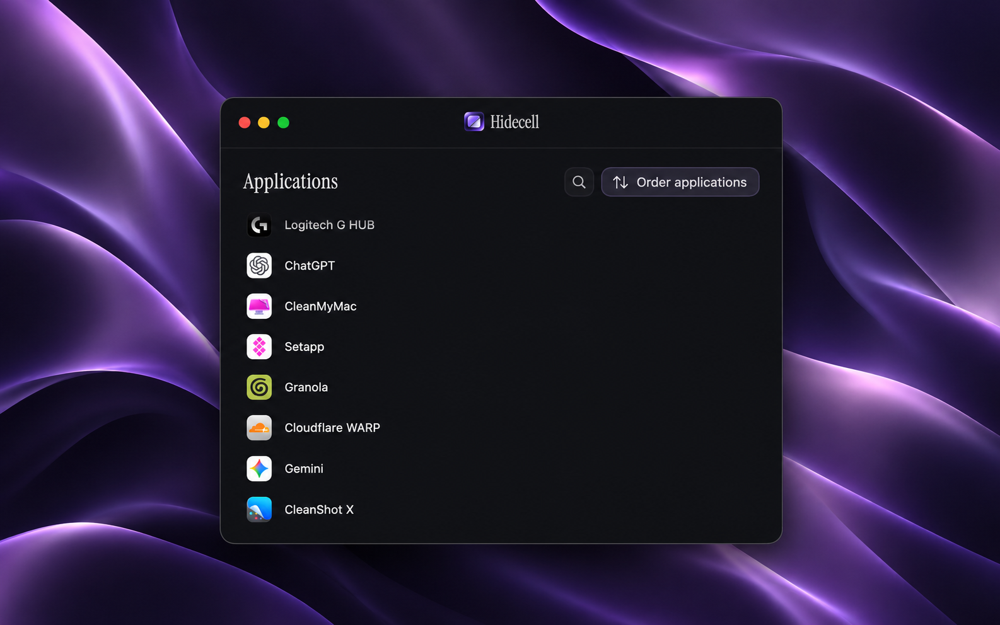
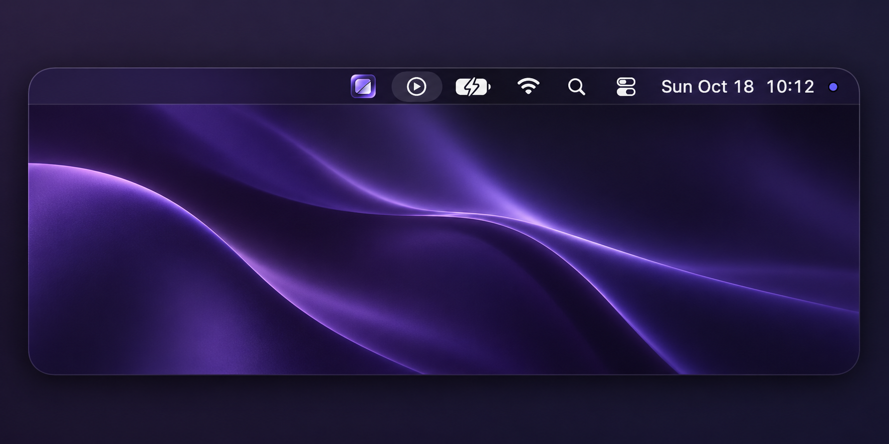
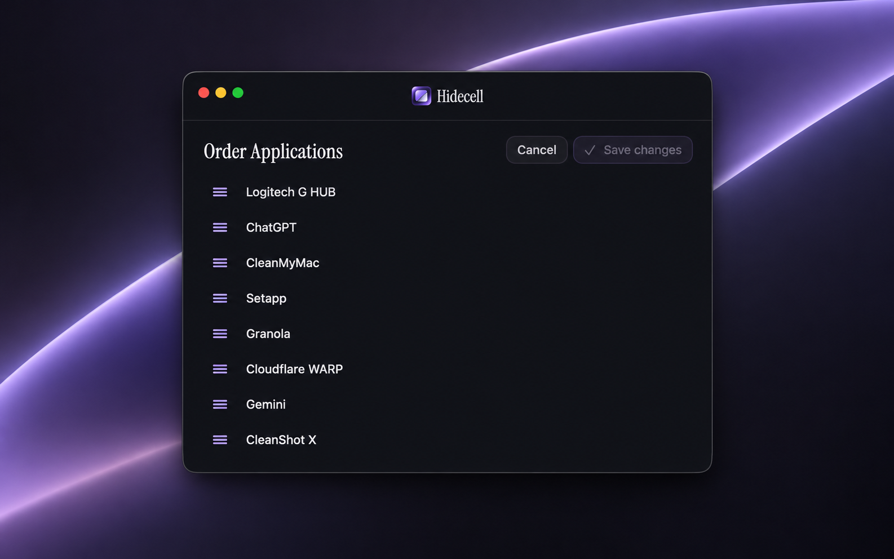

# Hidecell — V1 Node

A local macOS application for selecting which third-party menu bar icons to
hide and arranging their order. Changes are applied with Save changes.

## A closer look



### At home in the menu bar

Hidecell lives alongside your macOS status icons. Click its menu bar icon to
reveal or hide your saved selection.

[Watch the menu bar demo (MP4, 15 seconds)](docs/videos/hidecell-menu-bar-demo.mp4)

An unedited screen recording of Hidecell in use.



### Put your apps in order

Choose Order applications, drag rows into place, and choose Save changes.
Cancel leaves the saved order unchanged.



These are styled product illustrations based on actual application screenshots,
with AI-assisted wallpaper and presentation edits. They are not unmodified
screen captures; system icons and appearance may vary by macOS version.

## Requirements

- Apple Silicon and macOS 27 or later for the current build configuration.
- Xcode command-line developer tools with the macOS 27 SDK, plus Python 3.
- Accessibility permission; explicit access to the menu layout file when
  changing icon order. Session-only hiding does not write visibility preferences.

## Development

```sh
./test.sh
./build.sh
./package.sh ./Installers
```

The default build uses an ad hoc development signature. To use a certificate
already present in your local Keychain, set HIDECELL_SIGNING_IDENTITY to its
identity name or fingerprint before running build.sh. Never store private keys,
passwords, or notarization credentials in this repository.

The generated local package is unsigned as an installer and is not notarized.
Developer ID distribution requires a Developer ID Application signature, a
Developer ID Installer signature, notarization, and verification of the result.
The scripts do not perform notarization or upload anything.

## Application workflow

Click a row to change its draft hidden selection, then choose Save changes.
Cancel restores saved selections. Choose Order applications, drag rows, and
save to apply the menu order. The menu bar icon reveals or hides the saved
selection. Launch at login is configured by the application.

## Publication copy and compatibility

This sanitized publication copy uses app.hidecell.Hidecell, an independent
bundle identifier. It is not a drop-in update for earlier private builds:
preferences, login registration, and permissions are separate. Quit other
menu bar managers and private Hidecell builds before testing it. Existing
private builds and their data have not been changed by this preparation.

Menu visibility and ordering rely on internal macOS preference formats and
private APIs. Future OS releases may require changes. Other Macs, Intel builds,
and older macOS releases are not validated. A successful local build does not
establish release readiness across supported systems.

## Licensing

Third-party license notices are retained in THIRD-PARTY-LICENSE.txt and Fonts/.
No additional license grant has been selected for Hidecell's original code.
Choose a project license before presenting this repository as open source.
See THIRD-PARTY-NOTICES.md and SECURITY-REVIEW.md.

### Legacy visibility recovery (1.5.13–1.5.15)

Version 1.5.13 uses a session guardian for menu visibility writes. It restores original states on UI exit, force termination, or removal of the app executable, even if app preferences were deleted. It exits after recovery and installs no login agent. New hiding writes require a responsive guardian.

Recovery cannot run if the guardian itself is forcibly killed (SIGKILL), the machine loses power, or macOS denies preference access. Saved recovery preferences can be used by the legacy recovery tooling when available. No application can guarantee cleanup when all its processes and recovery data are removed together.

Run isolated crash/removal integration tests with:

```sh
xcrun swiftc -D RECOVERY_TESTING -module-cache-path .build/ModuleCache Sources/NativeVisibility.swift Sources/VisibilityGuardian.swift Tests/Recovery/main.swift -o .build/HidecellRecoveryTests
python3 Tests/Recovery/integration.py
```


### Session-only visibility (1.5.16)

New hiding sessions use a process-scoped macOS assertion rather than writing
Control Center's persistent `isAllowed` settings. Normal quit invalidates it;
macOS releases it on process death. A timer exits when the installed executable
is removed. This uses a private macOS interface and fails open when unavailable.
The older native-visibility code remains for recovery tooling and tests, not
for the application's hiding path. Old releases may require restoration of
their original preferences and a menu service refresh before migration.

Live verification on the development Mac: toggle, normal quit, forced kill,
and bundle removal by reversible rename. Direct CleanMyMac removal and the
clock-click compatibility handler have not yet been verified end-to-end.
